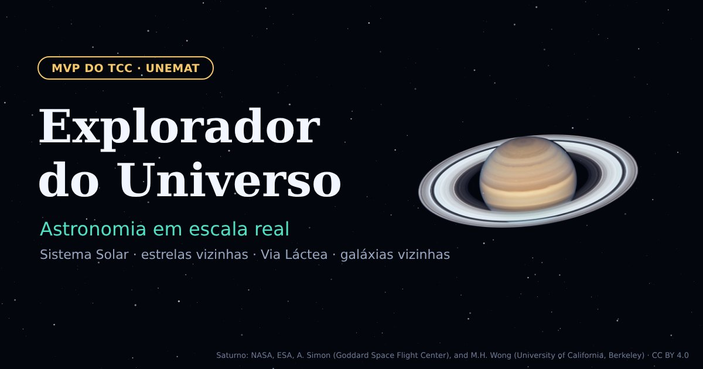
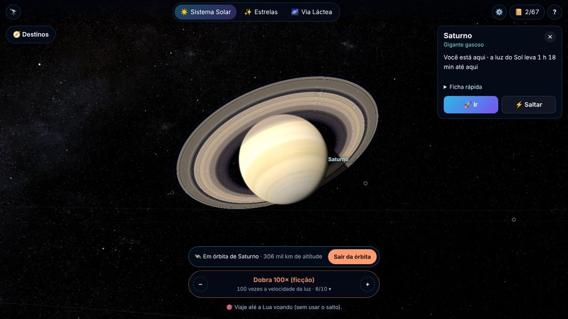
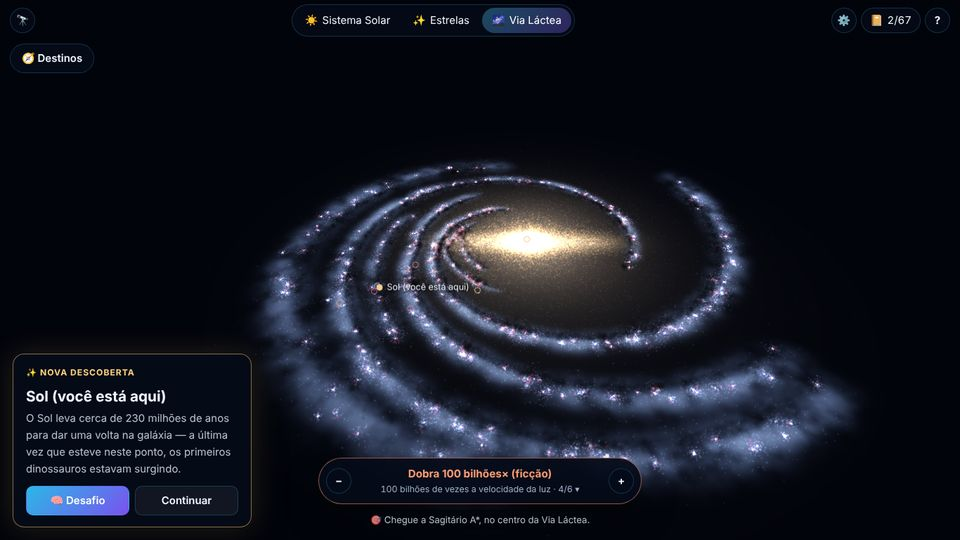
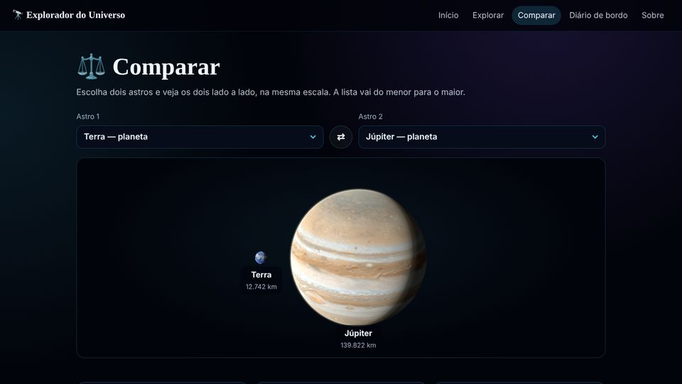

# 🔭 Explorador do Universo

**Astronomia em escala real.** Você pilota uma nave do Sistema Solar até a Via Láctea, com distâncias, tamanhos e posições de verdade, e guarda o que descobre no **Diário de bordo**.

> MVP do Trabalho de Conclusão de Curso de **Sistemas de Informação — UNEMAT, campus Sinop** · **Davi Alves Mares**

[](https://github.com/Davi-Mares/explorador-do-universo/actions/workflows/validar.yml)

🌐 **Acesse:** https://davi-mares.github.io/explorador-do-universo/

[](https://davi-mares.github.io/explorador-do-universo/)

<p align="center">
  
  
  
</p>

## O que tem

- **Explorar**, em três níveis de escala:
  - **Sistema Solar** — os planetas onde estão hoje (com o dia e a noite certos), a Lua e mais 10 luas, Plutão, Ceres, o Cinturão de Asteroides e as sondas Voyager 1 e 2, cada uma na trajetória de saída publicada pelo JPL, com o céu de verdade ao fundo.
  - **Estrelas vizinhas** — 30 estrelas para visitar, as 9 mil visíveis a olho nu nas posições 3D reais e uma régua de distâncias.
  - **Via Láctea** — os braços espirais medidos, a barra, nebulosas, aglomerados, Sagitário A* e as galáxias vizinhas: as Nuvens de Magalhães, Andrômeda e a do Triângulo, viradas como as vemos daqui.

  Ao chegar num astro, a nave entra em órbita: arrastar gira em volta e a rodinha (ou W/S, ou dois dedos) aproxima.
- **Comparar** — dois astros lado a lado, na mesma escala: de luas e planetas até galáxias e buracos negros.
- **Diário de bordo** — os verbetes do que você descobriu. São 67 astros, cada um com ficha técnica, as fontes com link e um desafio (67 desafios), mais 13 missões. Dá para **baixar em PDF**.

Funciona no computador e no celular, em pé ou deitado; em aparelhos mais simples a qualidade da imagem se ajusta sozinha para o voo ficar fluido. Sem cadastro: o progresso fica no navegador, e o site funciona offline (PWA).

## Como rodar

```bash
python3 -m http.server 8080      # ou: npm run servir
```

Abra **http://localhost:8080**. Não há dependências para instalar.

## Validação automática

```bash
npm run validar     # ou: node testes/validar-dados.mjs
```

São mais de 500 verificações, em duas frentes:

- **O modelo contra eventos reais e leis físicas** — equinócios, oposições, periélios, 3ª lei de Kepler para planetas e luas, rotação pela IAU, coordenadas galácticas, buracos negros e as trajetórias das Voyager (a saída da heliosfera de cada uma e a marca de 1 dia-luz da Voyager 1, em 18 de novembro de 2026, segundo a NASA).
- **A base de conhecimento** — todo astro tem ficha, pelo menos uma fonte com link e um desafio; toda foto tem o crédito oficial; os arquivos do modo offline existem.

O GitHub Actions roda tudo a cada envio.

## Estrutura

```text
├── index.html · explorador.html · comparar.html · diario.html · sobre.html
├── js/explorador/   # cálculos (astronomia.js), base de conhecimento (catalogo.js), cenas 3D e voo (main.js)
├── js/              # comparador, diário e o PDF (pdf.js, diario-pdf.js)
├── dados/           # estrelas do catálogo HYG (Hipparcos)
├── ferramentas/     # scripts Python que refazem os dados e os mapas (opcional)
├── testes/          # validação automática
└── css/ · img/ · pwa/
```

## Dados e imagens

Cada verbete do Diário mostra as suas fontes, com link. Em resumo:

- **Órbitas e fichas:** JPL/NASA (elementos orbitais, luas) e NASA NSSDC; eixos e rotação: IAU (Archinal et al., 2018). Contagem das luas dos planetas gigantes: NASA e JPL (junho de 2026).
- **Voyager 1 e 2:** elementos hiperbólicos publicados pelo JPL (S. Matousek, 1989) e as páginas da missão na NASA.
- **Estrelas:** catálogo HYG v4.0, a partir do Hipparcos (ESA) — `dados/estrelas.json` está sob CC BY-SA 4.0. As 30 estrelas para visitar têm a ficha com os dados do [SIMBAD](https://simbad.cds.unistra.fr/simbad/) (CDS, Estrasburgo).
- **Via Láctea:** braços medidos por Reid et al. (2019), barra de Wegg et al. (2015), disco de Bland-Hawthorn e Gerhard (2016), distância ao centro do GRAVITY (2019). Nebulosas e aglomerados: catálogos Messier e Caldwell do Hubble (NASA); Nebulosa de Órion: Menten et al. (2007); Sagitário A*: ESO (2022).
- **Galáxias vizinhas:** distâncias de Li et al. (2021), Breuval et al. (2023), Pietrzyński et al. (2019) e Graczyk et al. (2020); inclinação, giro e estrutura de cada uma a partir de artigos e da NASA, ESA e ESO.
- **Fotos do Diário:** NASA, JPL e ESA/Hubble (estas sob CC BY 4.0), cada uma com o crédito oficial no cartão do astro e na página [Sobre](https://davi-mares.github.io/explorador-do-universo/sobre.html).
- **Céu:** foto panorâmica da ESO/S. Brunier (CC BY 4.0).
- **Mapas:** [Solar System Scope](https://www.solarsystemscope.com/textures/) (CC BY 4.0), NASA (Blue Marble, New Horizons) e [Celestia](https://github.com/CelestiaProject/CelestiaContent) (CC BY) para as luas. Nebulosas, galáxias, buracos negros e os mapas de Europa, Calisto, Encélado e Caronte são ilustrações feitas por código.
- **Three.js** (MIT) para o 3D. As referências completas estão no documento do TCC.

---

<sub>Começou a partir da Wiki do Universo, trabalho da disciplina de Desenvolvimento Web ([aula-de-desenvolvimento-web](https://github.com/Davi-Mares/aula-de-desenvolvimento-web)).</sub>
