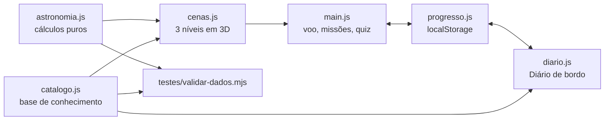

# 🔭 Explorador do Universo

**Astronomia em escala real** — um ambiente para ensinar astronomia a crianças e adolescentes, em que se explora o Sistema Solar, as estrelas vizinhas e a Via Láctea navegando como num jogo, sempre com as **distâncias reais**. Cada astro descoberto vira um verbete no **Diário de bordo**, a base de conhecimento que cresce junto com o estudante.

> MVP (produto mínimo viável) do Trabalho de Conclusão de Curso de **Sistemas de Informação — UNEMAT, campus Sinop**.
> Autor: **Davi Alves Mares**.

[](https://github.com/Davi-Mares/explorador-do-universo/actions/workflows/validar.yml)

🌐 **Site:** https://davi-mares.github.io/explorador-do-universo/ *(depois de ativar o GitHub Pages — veja [Publicar](#publicar-no-github-pages))*

---

## ✨ O que o MVP faz

| | |
|---|---|
| 🚀 **Explorador 3D** | Uma nave pilotável (teclado, mouse ou toque) por **três níveis de escala**: Sistema Solar (em UA), estrelas vizinhas (em anos-luz) e Via Láctea (em mil anos-luz). |
| 🪐 **Posições reais** | Os planetas aparecem **onde estão hoje**, calculados com os elementos orbitais do JPL/NASA. A Lua, a sonda Voyager 1 e a heliopausa também estão lá. Dá para acelerar o tempo e ver as órbitas acontecendo. |
| ⭐ **Estrelas de verdade** | 30 estrelas (Proxima Centauri, Sírius, Betelgeuse, Ácrux…) nas posições reais. O brilho muda conforme você se aproxima — Sírius vista de perto ofusca tudo. |
| 🌌 **A nossa galáxia** | O Sol no Braço de Órion, Sagitário A\* no centro, nebulosas, aglomerados, as Nuvens de Magalhães e Andrômeda, nas distâncias medidas. |
| 🛰️ **Velocidades reais** | Viaje como um carro, um avião, a ISS, a Voyager 1, a sonda Parker ou a luz — e veja quanto tempo cada uma levaria. As "dobras" acima da luz existem para dar tempo de visitar tudo e são sempre marcadas como **ficção**. |
| 🔍 **Tamanhos reais ou ampliados** | No modo real os planetas são pontinhos (porque são mesmo minúsculos perto das distâncias). No modo ampliado eles ficam 500× maiores — e a Lua some, porque ficaria dentro da Terra ampliada. |
| 📔 **Diário de bordo** | A base de conhecimento: cada descoberta libera um verbete com distâncias reais, tempo-luz, curiosidades e link para a Biblioteca. |
| 🏅 **Missões e desafios** | 10 missões ("Oito minutos de luz", "A vizinha mais próxima", "Além da Via Láctea"…) e 24 desafios de quiz com explicação. |
| 📖 **Biblioteca** | Textos, fotos e atividades (viagem da luz, linha do tempo, constelações) — a antiga *Wiki do Universo*. |
| 📲 **Leve e sem cadastro** | Funciona no navegador, instala como app (PWA) e roda offline. O progresso fica só no aparelho do estudante: **nenhum dado pessoal é coletado**. |

## ▶️ Como rodar

O site é estático (HTML, CSS e JavaScript), mas usa **módulos JavaScript**, então precisa ser aberto por um servidor — abrir o `index.html` com dois cliques não funciona.

```bash
# na pasta do projeto
python3 -m http.server 8080
# ou: npm run servir
```

Depois abra **http://localhost:8080**. Não há dependências para instalar.

### Controles do Explorador

| Ação | Teclado / mouse | Toque |
|---|---|---|
| Frente / ré | `W` `S` ou `↑` `↓` | botões ▲ ▼ |
| Para os lados | `A` `D` ou `←` `→` | — |
| Subir / descer | `R` `F` | — |
| Olhar em volta | arrastar com o mouse | arrastar |
| Trocar a velocidade | `+` `−` ou rodinha do mouse | botões − + |
| Parar o piloto automático | `Espaço` | botão ⏹ Parar |
| Ajuda | `H` | botão ? |

## ✅ Validação (sem testes com pessoas)

O modelo astronômico é conferido automaticamente contra eventos publicados e leis físicas:

```bash
npm run validar     # ou: node testes/validar-dados.mjs
```

São **179 verificações**, entre elas:

- **Calendário da Terra** — equinócios e solstícios de 2026 e o periélio de 3/jan/2026 (erro < 0,01°).
- **Oposições** — Marte (2025 e 2027), Júpiter, Saturno, Urano e Netuno (erro < 0,1°).
- **3ª lei de Kepler** — o período calculado de cada planeta bate com o período real (erro < 0,1%).
- **Coerência com a Biblioteca** — as distâncias dos textos batem com as órbitas do Explorador.
- **Fatos do quiz** — "os planetas cabem entre a Terra e a Lua", "a Voyager levaria 75 mil anos até Proxima"…
- **Lua e Voyager 1** — perigeu/apogeu da Lua e a Voyager a 1 dia-luz da Terra em nov/2026.
- **Integridade da base de conhecimento** — ids únicos, perguntas com resposta válida, missões apontando para objetos existentes, páginas da Biblioteca existentes.

O GitHub Actions roda essa validação a cada envio (o selo no topo mostra o resultado). A estratégia completa de validação está em [`docs/MVP-TCC.md`](docs/MVP-TCC.md).

## 🗂️ Estrutura

```text
.
├── index.html            # página inicial do MVP
├── explorador.html       # Explorador 3D
├── diario.html           # Diário de bordo (base de conhecimento + progresso)
├── biblioteca.html       # início da Biblioteca (antiga Wiki do Universo)
├── sol.html … netuno.html, universo.html, via-lactea.html, curiosidades.html
├── viagem-da-luz.html, linha-do-tempo.html, constelacoes.html   # atividades
├── sobre.html, pagina-de-contato.html
├── js/
│   ├── explorador/
│   │   ├── astronomia.js # cálculos puros: Kepler, coordenadas, Lua, formatação
│   │   ├── catalogo.js   # base de conhecimento: astros, estrelas, galáxia, missões, quiz
│   │   ├── cenas.js      # monta as três cenas 3D (Three.js)
│   │   ├── texturas.js   # texturas dos astros geradas por código
│   │   ├── progresso.js  # descobertas, missões e respostas (localStorage)
│   │   └── main.js       # voo, piloto automático, interface do explorador
│   ├── diario.js         # página do Diário de bordo
│   └── app.js, dados.js, …   # site da Biblioteca
├── css/                  # base, layout, componentes, explorador, diario, inicio…
├── testes/validar-dados.mjs
├── docs/MVP-TCC.md       # requisitos, arquitetura, validação, BNCC, próximos passos
└── pwa/                  # manifesto e service worker (offline)
```



## 🧰 Tecnologias

HTML5 · CSS3 · JavaScript (módulos ES) · [Three.js](https://threejs.org/) r160 (WebGL) · Bootstrap 5 (Biblioteca) · PWA · Node.js (validação, sem dependências) · GitHub Pages · GitHub Actions.

## 📚 Fontes dos dados

- **Órbitas:** E. M. Standish (JPL/NASA), *Keplerian Elements for Approximate Positions of the Major Planets* (válido de 1800 a 2050).
- **Planetas:** NASA Planetary Fact Sheet; eixos de rotação: IAU WGCCRE.
- **Lua:** fórmula de baixa precisão do *Astronomical Almanac*.
- **Estrelas:** coordenadas J2000 (SIMBAD) e distâncias por paralaxe (Hipparcos/Gaia). Distâncias de supergigantes (Betelgeuse, Antares, Rigel) são incertas.
- **Galáxia:** distância Sol–centro de 8,178 kpc (GRAVITY, 2019); braços espirais esquemáticos ajustados aos raios medidos na direção do Sol.
- **Voyager 1:** posição aproximada a partir da passagem pela heliopausa (25/ago/2012, 121,6 UA) e da velocidade de ≈ 3,58 UA/ano.

## 🌐 Publicar no GitHub Pages

1. No repositório: **Settings → Pages**.
2. Em **Build and deployment**, escolha **Deploy from a branch**, branch **`main`**, pasta **`/ (root)`**, e salve.
3. Em alguns minutos o site fica em `https://davi-mares.github.io/explorador-do-universo/`.

> O GitHub Pages em repositório privado depende do plano da conta; em repositório público é gratuito.

## 🛣️ Próximos passos

- **Realidade aumentada (WebXR):** colocar o Sistema Solar em escala na mesa da sala de aula.
- **Modo turma:** professor cria missões e acompanha o progresso (exigiria um backend e cuidado com a LGPD).
- **Mais céu:** catálogo estelar maior (ex.: HYG), exoplanetas e constelações ligadas ao nível das estrelas.
- **Acessibilidade:** narração por voz e alternativa em lista para quem não usa a visão 3D.

## 🌱 Origem

O projeto começou como a **Wiki do Universo**, feita na disciplina de Desenvolvimento Web ([aula-de-desenvolvimento-web](https://github.com/Davi-Mares/aula-de-desenvolvimento-web)). No MVP ela virou a Biblioteca, e o Explorador 3D, o Diário de bordo, as missões e a validação foram construídos em cima dela.
